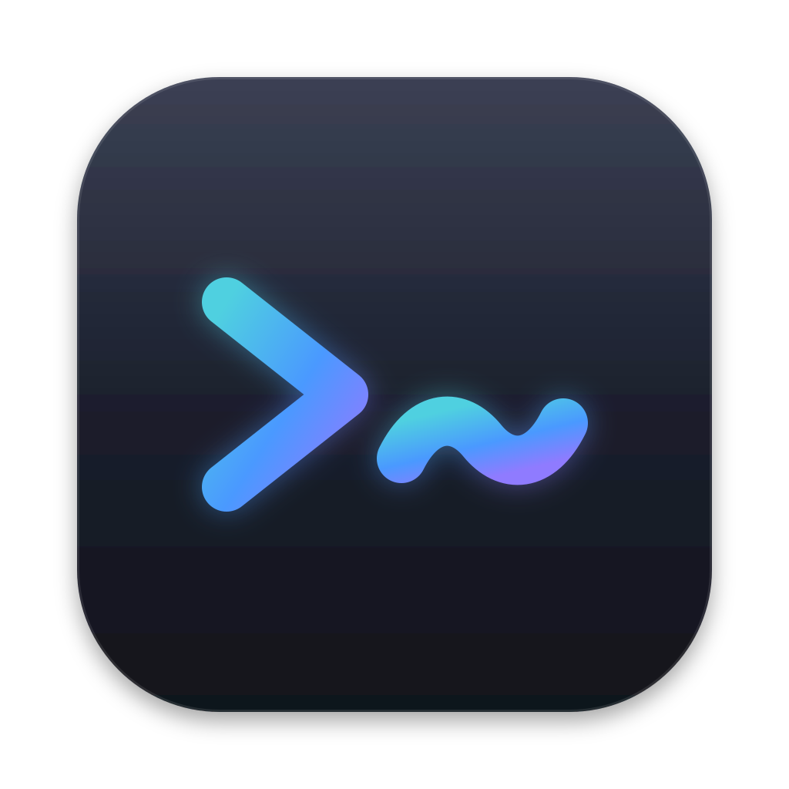
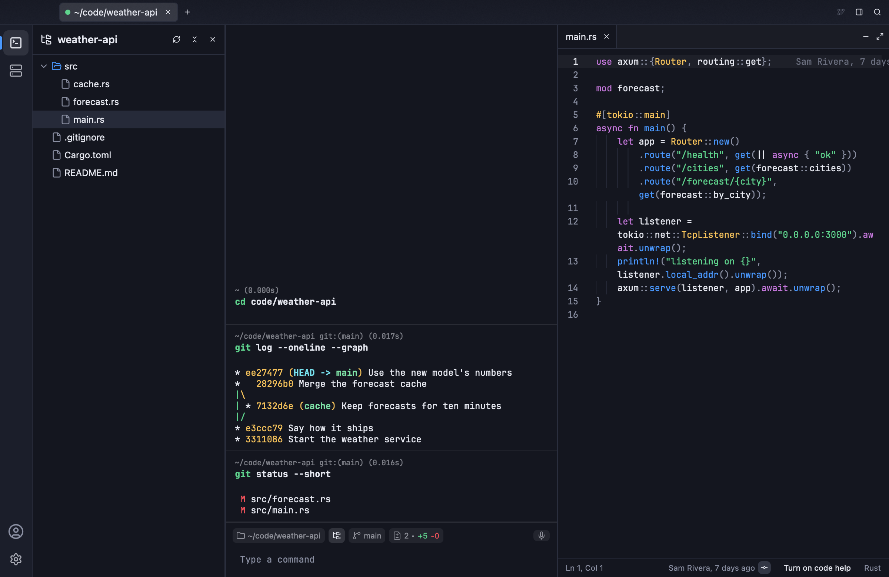
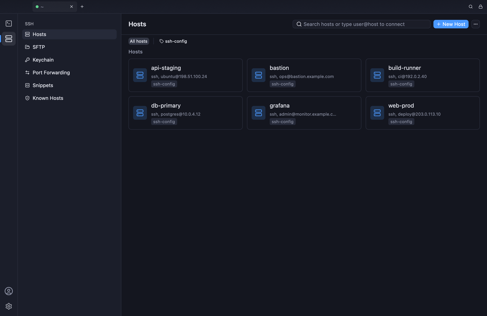
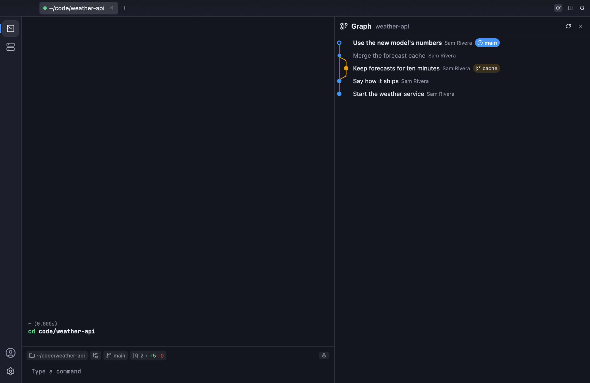
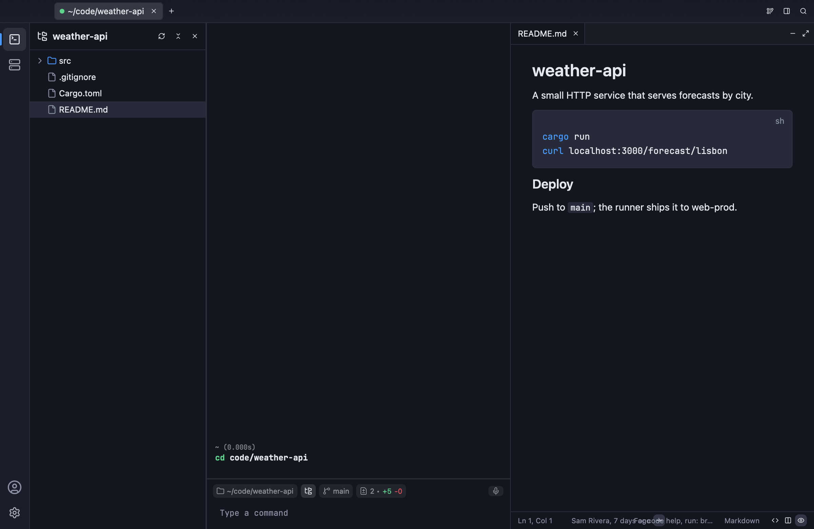
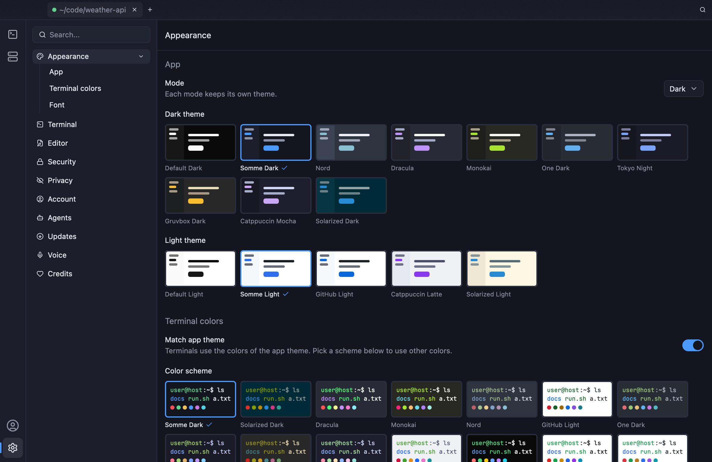

<div align="center">
  

  <h1>Somme</h1>

  <p><strong>A native SSH client and terminal, written in Rust.<br />Hosts, keys, SFTP, port forwarding, a code editor and git, in one fast app.</strong></p>

  <p>
    <a href="https://github.com/kahflane/Somme/releases/latest"></a>
    <a href="https://github.com/kahflane/Somme/releases"></a>
    <a href="LICENSE"></a>
  </p>
  <p>
    
    
    
    
    
    
  </p>

  <p>
    
  </p>

  <p>
    <a href=".github/images/hosts.png"></a>
    <a href=".github/images/graph.png"></a>
  </p>
  <p>
    <a href=".github/images/markdown.png"></a>
    <a href=".github/images/themes.png"></a>
  </p>
</div>

## Why Somme?

<table>
  <tr>
    <td width="50%" valign="top">
      <h3>⚡ Native, not a web page</h3>
      <p>Built in Rust on GPUI, the GPU-drawn UI toolkit behind the Zed editor. No Electron, no bundled browser. It opens fast and scrolls smoothly, even with huge logs.</p>
    </td>
    <td width="50%" valign="top">
      <h3>🔐 Your secrets stay yours</h3>
      <p>Passwords, keys and passphrases are sealed with XChaCha20-Poly1305 under your master password (Argon2) before they are saved or synced. The password never leaves your computer.</p>
    </td>
  </tr>
  <tr>
    <td width="50%" valign="top">
      <h3>🧰 Everything for a server, in one place</h3>
      <p>Hosts, groups, tags, SSH keys, jump hosts, SFTP, port forwarding, snippets and known hosts. Sign in, and they follow you to every computer.</p>
    </td>
    <td width="50%" valign="top">
      <h3>🧑‍💻 More than a terminal</h3>
      <p>A file tree, a code editor with language servers, git changes, a commit graph, and GitHub pull requests and issues, all beside the terminal. On your computer or on the server.</p>
    </td>
  </tr>
  <tr>
    <td width="50%" valign="top">
      <h3>🤖 Ready for AI agents</h3>
      <p>Somme is an MCP server. Claude Code and other agents can run scripts on your saved servers, and every script is logged before it runs. Off until you turn it on.</p>
    </td>
    <td width="50%" valign="top">
      <h3>🎙️ Talk instead of type</h3>
      <p>Hold Space in the command box and speak. Whisper turns it into text on your computer. Nothing is sent anywhere.</p>
    </td>
  </tr>
</table>

## Features

### SSH and hosts

- **Hosts** with groups, tags, colors and the server's system logo
- **Keychain** for SSH keys and identities: generate, import or paste
- **Jump hosts**, startup snippets and per-host session logs
- **Known hosts** you can check and clean up
- **Import** your hosts from `~/.ssh/config` in one click
- **Quick connect**: type `user@host` in the search box

### Terminal

- **Command blocks**: each command and its output is a block you can copy, search or share
- **Command box** with history, Tab completion and the current folder, branch and changes at a glance
- **Split panes** in any direction, and **broadcast** typing to all of them
- **Pinned tabs** that come back at the next start
- **Programs get their keys**: Tab, Shift+Tab and Ctrl+C reach Vim, Claude Code and other full-screen tools

### Files

- **SFTP** between your computer and any host, in any direction
- **File tree** beside the terminal. It follows the shell into folders, on your computer or over SSH
- **Command palette** finds files by name or by the text in them
- **Open with Somme** from Finder, Explorer or your file manager, or run `Somme <path>`

### Editor

- **Syntax colors** for 35 languages
- **Language servers** for code help: suggestions, errors and go to definition. Somme downloads them when you ask, and checks each download
- **Markdown preview** with Mermaid diagrams, and **jq** for JSON files
- **Git blame** on the current line
- Minimize, maximize and restore the editor beside the terminals

### Git and GitHub

- **Changes**: see, stage and commit what changed, then push or publish a branch
- **Commit graph** of the shell's repository
- **Pull requests and issues** of the GitHub repository you are in

### Port forwarding

- **Local**, **remote** and **dynamic** (SOCKS) tunnels, saved per host

### Sync and security

- **Encrypted vault** behind a master password, with auto unlock on your own computer
- **Somme Cloud** syncs hosts, keys, snippets and your look between computers
- **Signed updates**: Somme installs an update only when its signature checks out

### Look

- **15 app themes** and many terminal color schemes, light and dark, each mode with its own
- **JetBrains Mono** built in, so code lines up on any computer

## Install

Download the latest build from [**Releases**](https://github.com/kahflane/Somme/releases/latest).

| System | File | How |
|---|---|---|
| macOS (Apple chip and Intel) | `Somme-<version>-macos-universal.zip` | Unzip, then drag `Somme.app` to Applications. |
| Windows | `Somme-<version>-windows-x86_64.zip` | Unzip, then run `Somme.exe`. |
| Linux | `Somme-<version>-linux-x86_64.tar.gz` | Unpack, then run `somme`. A `.desktop` file and icon are inside. |

The Windows build isn't signed yet, so Windows may say "Windows protected your PC" the first time. Click **More info**, then **Run anyway**.

Somme checks for new versions by itself and shows a button when one is ready.

Somme changes your system only when you say so. On Windows and Linux it asks before it adds itself to Open With. It starts at login only if you turn on the background service for agents.

### Uninstall

1. Run `Somme --uninstall`. On macOS that is `/Applications/Somme.app/Contents/MacOS/Somme --uninstall`. It takes Somme out of Open With and stops it starting at login.
2. Delete `Somme.app`, `Somme.exe` or the `somme` folder.
3. To remove your data too, delete Somme's data folder:
   - macOS: `~/Library/Application Support/app.somme.desktop`
   - Windows: `%APPDATA%\app.somme.desktop`
   - Linux: `~/.local/share/app.somme.desktop`
4. If you used auto unlock, delete the key named `app.somme.vault` from the system keychain.

## Privacy

Somme has no ads, no analytics and no tracking. It connects only to the servers you add, and to these, for the reasons given:

| Where | When | Why |
|---|---|---|
| GitHub (`api.github.com`) | Every few hours, unless you turn off Settings › Updates › Check for updates | To see if a new Somme is out |
| Somme Cloud | Only after you sign in | To sync your hosts, snippets and look. Passwords and keys are encrypted with your master password first |
| GitHub | Only after you sign in with GitHub | To show pull requests, issues and profile pictures |
| Hugging Face, Node.js, npm, GitHub | Only when you ask for voice typing or code help | To download the voice model or a language server, each checked against its known hash |
| Web addresses in a Markdown file | When you open that file | To show its images. Only secure addresses on the open internet are fetched |

Somme Cloud runs on [Fly.io](https://fly.io) and stores data with [Turso](https://turso.tech). See their privacy policies: [Fly.io](https://fly.io/legal/privacy-policy), [Turso](https://turso.tech/privacy-policy).

## Code signing

Mac builds are signed with our Apple Developer ID and notarized by Apple. Windows builds aren't signed yet. Every release is built from this repository by [GitHub Actions](.github/workflows/release.yml), and each file's SHA-256 is in `SHA256SUMS` on the release.

## Build from source

You need Rust 1.88 or newer.

```sh
git clone https://github.com/kahflane/Somme.git
cd Somme
cargo run -p somme-desktop
```

On macOS, `crates/somme-desktop/macos-app.sh --release` builds `Somme.app` with its name and icon. On Linux, install these first (Debian and Ubuntu names):

```sh
sudo apt-get install pkg-config cmake clang libssl-dev libdbus-1-dev libasound2-dev \
  libxkbcommon-dev libxkbcommon-x11-dev libwayland-dev libx11-dev libx11-xcb-dev \
  libxcb1-dev libvulkan-dev libfontconfig1-dev libfreetype6-dev libzstd-dev
```

Run the tests with `cargo test --workspace`.

## Tech stack

| Part | Built with |
|---|---|
| UI | [GPUI](https://www.gpui.rs) |
| Terminal | [alacritty_terminal](https://github.com/alacritty/alacritty), [portable-pty](https://github.com/wezterm/wezterm) |
| SSH, SFTP and tunnels | [russh](https://github.com/Eugeny/russh), [russh-sftp](https://github.com/AspectUnk/russh-sftp) |
| Data and sync | [Turso](https://turso.tech) |
| Encryption | XChaCha20-Poly1305 and Argon2, from [RustCrypto](https://github.com/RustCrypto) |
| Editor | [tree-sitter](https://tree-sitter.github.io), [ropey](https://github.com/cessen/ropey), language servers over LSP |
| Voice | [whisper.cpp](https://github.com/ggml-org/whisper.cpp) through [whisper-rs](https://github.com/tazz4843/whisper-rs) |

Every library Somme ships with is listed in the app, under Settings › Credits.

## Contributing

Bug reports, ideas and pull requests are welcome. Open an [issue](https://github.com/kahflane/Somme/issues) first for big changes.

<a href="https://github.com/kahflane/Somme/graphs/contributors">
  
</a>

## License

Somme is free software under the [GNU Affero General Public License v3.0](LICENSE). You can use, change and share it. If you share a changed version, or run one for others over a network, you must share its source under the same license.
